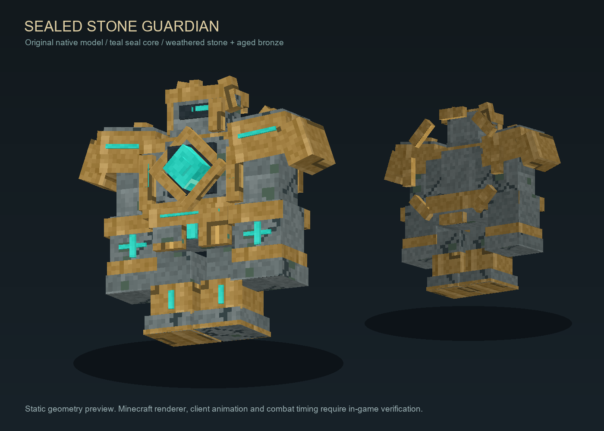

# 첫 시험 레이드 — 봉인된 수호자

2026-10-13, HanesTest 게임 1.0.28 개발 소스. 이 레이드는 전투·봉인·협력·승패·복귀 경로를 시험하기 위한 **비정사 프로토타입**이다. 기존 신의 정체·세계관상 사망·진행도나 운영 레이드 밸런스를 확정하지 않는다. 빌드·GameTest·배포·실제 클라이언트 확인 결과는 [이번 인수인계](../../인수인계/브랜치실험/HanesTest/RAID_TRIAL_20261013.md)에서 구분한다.

## 준비와 참가

시험 레이드 ID는 `mythictrpg:trial/sealed_guardian`, 전용 차원은 `mythictrpg:raid_trial`이다. 첫 시험의 콘텐츠 범위는 **1~4명, 1인당 3목숨, 전투 제한 10분**이다. 모집을 만든 것과 실제 전투 시작은 서로 다른 상태다.

1. 시험 코드와 차원 리소스가 포함된 서버·클라이언트 게임 JAR을 맞추고 서버를 정상 부팅한다. 이 문서가 배포나 부팅을 실행하지는 않는다. 새 차원이 없는 실행 상태에서는 준비 명령이 실패하며 전장을 다른 월드에 대신 만들지 않는다.
2. OP 권한 2 이상으로 `/mythraid trial prepare`를 실행한다. 명령은 전용 차원의 빈 구역에 전장을 준비한다. 일반 플레이어는 전장을 생성할 수 없다.
3. 테스트 장비가 필요하면 기본 인벤토리에 빈칸 9개를 확보한 **OP 플레이어 본인**이 `/mythraid trial kit`를 실행한다. 철 검, 철 방어구 4종, 방패, 스테이크 32개, 활, 화살 32개를 지급한다. 방어구·방패는 직접 착용한다. 기존 인벤토리를 비우거나 덮지 않으며 빈칸 부족 시 지급하지 않는다. 이 명령은 매번 명시적으로 아이템을 지급하므로 반복 실행 여부는 시험 관리자가 결정한다.
4. 리더가 `/mythraid trial create`를 실행해 모집 UUID를 받는다. 이 명령은 기존 게임 `RaidRuntime.create`를 호출하며 입장 조건·중복 참가 등 기존 검증을 따른다.
5. 다른 참가자는 `/mythraid` 화면 또는 `/mythraid join <UUID>`로 참가한다. 전투 시작 전에 인원·장비를 확인하고, 리더가 화면의 시작 버튼 또는 `/mythraid start <UUID>`를 사용한다. 시작하면 명단이 고정되고 실제 입장 경로를 따른다.

`/mythraid trial`은 위 명령을 안내한다. `/mythraid status <UUID>`와 `/mythraid mine`으로 시도 상태를 확인할 수 있다. 모집 중 비리더의 탈퇴는 `/mythraid leave <UUID>`, 리더의 전체 취소는 `/mythraid cancel <UUID>`다. 기존 [레이드 실행·UI 계약](RAID_RUNTIME.md)의 권한·초대·보상 자격 검증이 계속 적용된다.

게임 1.0.29의 `/mythraid` 화면 상단에서 **모집 중 / 진행 중 / 완료 기록**을 선택할 수 있다. 모집 중에는 참가할 모집과 새 모집 생성 항목, 진행 중에는 대기·전투·정산 중인 시도, 완료 기록에는 본인이 참가한 클리어·실패·취소 기록이 표시된다(OP는 관리 조회 가능). 새로고침해도 선택한 탭을 유지한다. 이 UI 버전은 protocol 11이므로 서버와 클라이언트의 게임 모드를 함께 1.0.29로 교체해야 한다.

## 전장과 봉인 위치

전장은 원형 반경 약 22블록이며, 바닥 높이는 y80이다. 두꺼운 어두운 석재 바닥, 새겨진 룬, 발광 기둥, 봉인 받침 3개와 밖 복귀 발판이 있다.

| 요소 | 좌표 |
|---|---|
| 입장 | `(0.5, 81, 17.5)` |
| 보스 시작 | `(0.5, 81, 0.5)` |
| 북쪽 봉인 받침 | `(0, 81, -15)` |
| 남서쪽 봉인 받침 | `(-13, 81, 8)` |
| 남동쪽 봉인 받침 | `(13, 81, 8)` |
| 전장 밖 복귀 발판 | `(0.5, 81, 30.5)` |

전투 구역의 경계는 `(-24,79,-24)`부터 `(24,96,24)`다. 봉인 받침은 고정 lodestone 블록이다. 봉인은 블록을 부수거나 클릭하지 않고 곁에서 웅크려 해제한다. 모델의 애니메이션만으로 공격이나 봉인 성공을 판정하지 않는다.

## 전투와 기믹

생존 모드에서 철 방어구와 철 검으로 시작한다. 보스는 중앙에 고정된 석상이고 가슴 핵·몸통을 공격한다. 체력은 고정 참가자 수에 따라 180/250/320/390이며 방어력은 8이다. 팔 끝과 떠 있는 장식은 별도 피격 부위가 아니다. 보스바, 행동막대와 바닥 주황 입자로 공격·기믹을 안내한다. 시간은 서버 20 TPS 기준이다.

| 공격 | 피하는 방법 | 예고 / 기본 피해 |
|---|---|---|
| 전방 휩쓸기 | 예고 시작 때 고정된 방향의 측면·뒤로 이동. 반경 8, 전체각 120도 | 2초 / 6 |
| 환형 충격파 | 중앙 3블록 미만 또는 11블록 밖으로 이동 | 2.4초 / 6 |
| 봉인 낙하 | 참가자 위치에 고정된 반경 2.5 원에서 벗어나기. 겹친 원도 같은 공격은 한 번만 피해 | 2초 / 4 |

피해는 방어구 적용 전 Minecraft 체력 단위다. 서버가 참가자·차원·전장 범위·살아 있음·탈락·리스폰 대기를 재검증하고, 예고에 쓴 중심·방향·목표점을 고정해 한 번 판정한다. y높이는 바닥 기준 -0.5~3으로 제한한다. 입자 설정을 최소로 낮추면 범위 파악이 어려울 수 있어 시험 시 모든 입자를 권장한다.

1. **1단계:** 세 공격을 순환한다. 체력 65% 이하를 감지하면 현재 공격을 취소하고 보호막을 올린다.
2. **봉인 기믹:** 45초 안에 세 봉인을 모두 해제한다. 각 받침의 2.5블록 이내에서 2초 연속 웅크린다. 도중에 일어나거나 벗어나면 해당 받침의 미완료 충전은 초기화된다. 이미 완료한 봉인은 유지되어 혼자 순서대로 풀거나 여럿이 나눠 풀 수 있다. 보호막 중에는 보스가 피해를 받지 않으며 낙하 공격은 계속된다.
3. **2단계:** 성공하면 보호막이 풀리고 5초간 공격하지 않는다. 시간 초과 시 참가자에게 기본 피해 6의 결계 폭발 후 보호막을 해제하고 1초 뒤 회복한다. 실패해도 봉인 상태에 영구 갇히지 않는다.
4. **3단계:** 체력 30% 이하에서 핵이 과부하된다. 공격 예고가 0.6초 짧아지고 회복·공격 간격도 짧아진다. 봉인을 성공한 직후라면 약속한 5초 무방비 시간은 유지한다.

큰 단일 피해로 체력을 한 번에 소진하면 임계값 기믹을 건너뛸 수 있다. 현재 프로토타입은 강제 체력 잠금·부위별 파괴·무력화 게이지·보스별 데이터형 패턴 편집기를 포함하지 않는다. 전장/봉인 좌표와 시련 ID는 전용 제어기에 연결되어 있으므로 JSON만 옮겨 새 레이드를 만드는 범용 프리셋으로 취급하지 않는다.

## 모델과 리소스

모델은 직접 작성한 Minecraft 네이티브 geometry 28파트·87큐브다. 석재 갑옷, 청동 테두리, 청록색 핵, 분리된 봉인 파편과 7개 자세를 포함한다. 기본/발광 PNG는 각각 256×256이며, 음향·전장 블록·입자는 Minecraft 기본 리소스를 참조한다. 외부 모드의 모델을 추출하거나 GeckoLib 같은 추가 실행 의존성을 설치하지 않았다.

편집 원본은 [Java 모델](../src/main/java/com/sande/mythictrpg/client/raid/trial/SealedGuardianModel.java)과 [텍스처·미리보기 생성 스크립트](../../dev-tools/raid-trial-artwork.py)다. Python/Pillow/NumPy 환경에서 스크립트를 실행하면 동일 텍스처와 정적 미리보기를 재생성한다. 미리보기는 Minecraft 화면 캡처가 아니며 게임의 조명·셰이더·애니메이션 검증을 대신하지 않는다. 외부의 상세 모델과 혼용하는 후속 보스는 각각 라이선스·파일 형식·리깅·렌더러·판정 연결을 별도로 확인해야 한다.

## 보상과 정사 경계

이번 시련의 `rewards`와 `offerGodIds`는 빈 배열이다. 승리는 기존 레이드 상태에 남지만 아이템·화폐·호감도 보상과 신의 AI 제안은 없다. 스키마가 요구하는 `rewardGodId`의 기존 Demeter ID는 빈 보상에서 사용되지 않는 호환 필드이며 이 시련을 해당 신의 사건으로 만들지 않는다. 일반 드롭·XP도 기존 레이드 보호기가 차단한다. 시련 ID의 승패는 `ImportantEvents`/Story 진행 신호를 발행하지 않는다. 기존 일반 레이드의 보상 영수증·Story 경로는 유지한다.

## 전장 보존과 정리

`prepare`는 기존 플레이어 월드를 수정하지 않는다. 전용 차원의 제한된 구역과 20개 chunk만 확인하며 첫 생성 전에 블록·유체·엔티티 존재 여부를 검사한다. 기존 편집이 있으면 아무것도 덮지 않는다. 생성 사실은 해당 전용 차원의 SavedData에 기록한다.

준비 명령을 다시 실행해도 전장을 원상복구하거나 장식을 덮어쓰지 않는다. 필수 바닥·경계·봉인·입장/보스/복귀 공간이 손상되면 실패하며 관리자에게 상태를 알린다. 시험 시도가 대기·전투·정산·정리 중이면 명령에서 준비를 거절한다. 전장 자동 롤백·월드 복제·월드 삭제 기능은 없다.

정상 종료·취소·실패와 재시작 정리는 기존 레이드 엔진을 따른다. 보스의 일반 드롭·XP와 작성형 보상을 별도 지급원으로 중복 처리하지 않는다. 종료 상태라도 `CLEANUP_PENDING`이면 실제 보스·구역 점유·복귀 상황을 확인해야 한다. 운영 월드와 플레이어 데이터를 지워 상태를 해결하지 않는다.

## 소스와 확인 범위

- [시험 명령](../src/main/java/com/sande/mythictrpg/raid/TrialRaidCommands.java): 안내, 관리자 준비, 플레이어 모집 생성, 명시적 자기 장비 지급.
- [전장 준비](../src/main/java/com/sande/mythictrpg/raid/TrialRaidArenaService.java): 제한된 생성, 생성 기록, 기존 편집 보존, 필수 공간 검사.
- [차원 정의](../src/main/resources/data/mythictrpg/dimension/raid_trial.json), [차원 타입](../src/main/resources/data/mythictrpg/dimension_type/raid_trial.json): 전용 void 차원, 바닐라 레이드 비활성, 침대·리스폰 앵커로 부활 지점 지정 불가 설정.
- [기존 실행·영속성·보상 계약](RAID_RUNTIME.md): 실제 승패, 참가자 고정, 중복 보상 방지, 귀환과 정리.

소스 구현·컴파일·자동 GameTest와 실제 클라이언트의 외형·애니메이션·조작·난이도 확인은 구분한다. 이 시련은 첫 기능 검증용이며 운영 적용이나 실제 4인 플레이의 재미·난이도 검증 완료를 선언하지 않는다.
